# Part 1C — Data Architecture

Covers: design changes from the requested CSV list, normalized relational schema, ER diagram, data dictionary, CSV → table mapping, import commands, and integrity checks.

Files:
- `sql/01_schema.sql` — PostgreSQL DDL (schema `temple`): tables, domains, constraints, indexes, views
- `sql/02_seed_reference.sql` — lookup tables + data-source registry
- `sql/03_integrity_checks.sql` — 13 referential-integrity / DQ checks
- `sql/04_constraint_tests.sql` — 8 known-bad inserts that must be rejected (all verified rejected on PostgreSQL 16)

---

## 1. Design changes from the requested CSV list (and why)

| Requested | Change | Reason |
|---|---|---|
| `community_survey.csv` with multi-value "preferred programs" and "main barriers" | Kept in the **raw** CSV as semicolon lists (realistic export format). In the database, split into child tables `survey_top_choice` and `survey_barrier`. | First normal form: one value per cell. Lets SQL count barriers and rank top choices without string parsing. |
| Program categories as free text | New lookups `program_category` (11 canonical codes) and `program_category_alias` (38 messy labels → code). | Equivalent labels ("Bal Vihar", "kids classes") must aggregate together; the alias table makes the mapping auditable and reusable in Python and SQL. |
| Barriers as free text | New lookup `barrier_type`. | Controlled vocabulary. |
| Cost category as free text in two cost tables | New lookup `cost_category` with `cost_type` (startup / operating). | Prevents a startup category appearing in operating costs (check IC-08). |
| Operating model as free text | New lookup `operating_model`, linked to strategy code. | Consistent codes across cost, funding, scorecard. |
| `property_due_diligence.csv` with one column per review area | **Long format**: one row per property × review area (5 rows per property), with status, next action, owner, and estimated cost to resolve **per area**. A view `v_property_dd_wide` pivots back to wide. | Each review area needs its own next action, cost, and date; wide format would require 20+ repeated columns. |
| Assumptions scattered across scenarios | New table `model_assumption` (low/base/high) | NFR-03: every constant in calculations must live in one auditable place. |
| — | New table `dq_issue_log` | FR-07: every cleaning decision is recorded, nothing is silently deleted. |
| — | `data_status` + `source_id` on every fact table; `is_simulated` on properties | Distinguish real, synthetic, assumed, and verified records at row level. |
| Duplicate survey submissions | `is_duplicate` + `duplicate_of` (self-FK) on `survey_response` | Duplicates are retained and flagged, not deleted. |

### `data_status` values (domain `data_status_t`)

| Value | Meaning | Portfolio usage |
|---|---|---|
| `real_observation` | Collected from a real person, event, or record | **None in this portfolio** |
| `synthetic` | Simulated practice record | Survey, preferences, properties, due diligence, costs, programs |
| `unverified_assumption` | Analyst/committee assumption awaiting validation | Funding scenarios, model assumptions |
| `verified_official` | Written quote, official document, or confirmed information | Only context documents in `data_source` (SRC101–SRC105) |

### `verification_status` values (domain `verification_t`) — applies to cost/program/assumption lines

`verified_quote` · `published_rate` · `official_document` · `analyst_estimate` · `synthetic_placeholder`

---

## 2. Entity-relationship diagram

```mermaid
erDiagram
    DATA_SOURCE ||--o{ SURVEY_RESPONSE : documents
    DATA_SOURCE ||--o{ PROGRAM_PREFERENCE : documents
    DATA_SOURCE ||--o{ PROGRAM_OPTION : documents
    DATA_SOURCE ||--o{ CANDIDATE_PROPERTY : documents
    DATA_SOURCE ||--o{ PROPERTY_DUE_DILIGENCE : documents
    DATA_SOURCE ||--o{ STARTUP_COST_ESTIMATE : documents
    DATA_SOURCE ||--o{ OPERATING_COST_ESTIMATE : documents
    DATA_SOURCE ||--o{ FUNDING_SCENARIO : documents
    DATA_SOURCE ||--o{ MODEL_ASSUMPTION : documents

    SURVEY_RESPONSE ||--o{ PROGRAM_PREFERENCE : rates
    SURVEY_RESPONSE ||--o{ SURVEY_TOP_CHOICE : selects
    SURVEY_RESPONSE ||--o{ SURVEY_BARRIER : reports
    SURVEY_RESPONSE |o--o{ SURVEY_RESPONSE : "duplicate_of"

    PROGRAM_CATEGORY ||--o{ PROGRAM_PREFERENCE : categorizes
    PROGRAM_CATEGORY ||--o{ SURVEY_TOP_CHOICE : categorizes
    PROGRAM_CATEGORY ||--o{ PROGRAM_OPTION : categorizes
    PROGRAM_CATEGORY ||--o{ PROGRAM_CATEGORY_ALIAS : "has aliases"
    BARRIER_TYPE ||--o{ SURVEY_BARRIER : classifies

    CANDIDATE_PROPERTY ||--|{ PROPERTY_DUE_DILIGENCE : "has 5 review areas"

    OPERATING_MODEL ||--o{ STARTUP_COST_ESTIMATE : "costed for"
    OPERATING_MODEL ||--o{ OPERATING_COST_ESTIMATE : "costed for"
    COST_CATEGORY ||--o{ STARTUP_COST_ESTIMATE : classifies
    COST_CATEGORY ||--o{ OPERATING_COST_ESTIMATE : classifies

    SURVEY_RESPONSE {
        varchar respondent_id PK
        date response_date
        boolean consent_flag
        varchar attendance_frequency
        smallint max_travel_minutes
        numeric monthly_contribution_stated
        boolean is_duplicate
        varchar duplicate_of FK
        varchar data_status
        varchar source_id FK
    }
    PROGRAM_PREFERENCE {
        varchar preference_id PK
        varchar respondent_id FK
        varchar category_code FK
        smallint interest_rating
        varchar preferred_frequency
    }
    SURVEY_TOP_CHOICE {
        varchar respondent_id PK,FK
        varchar category_code PK,FK
        smallint choice_rank
    }
    SURVEY_BARRIER {
        varchar respondent_id PK,FK
        varchar barrier_code PK,FK
    }
    PROGRAM_CATEGORY {
        varchar category_code PK
        varchar category_name
        varchar category_group
    }
    PROGRAM_CATEGORY_ALIAS {
        varchar alias_text PK
        varchar category_code FK
    }
    BARRIER_TYPE {
        varchar barrier_code PK
        varchar barrier_name
    }
    PROGRAM_OPTION {
        varchar program_id PK
        varchar category_code FK
        numeric est_launch_cost
        numeric est_monthly_cost
        smallint volunteer_hours_month
        boolean requires_permanent_space
    }
    CANDIDATE_PROPERTY {
        varchar property_id PK
        varchar jurisdiction
        varchar property_type
        varchar tenure_offered
        integer floor_area_sqft
        smallint parking_spaces
        boolean is_simulated
    }
    PROPERTY_DUE_DILIGENCE {
        varchar dd_id PK
        varchar property_id FK
        varchar review_area
        varchar status
        numeric est_cost_to_resolve
    }
    OPERATING_MODEL {
        varchar model_code PK
        varchar strategy_code
    }
    COST_CATEGORY {
        varchar cost_category_code PK
        varchar cost_type
    }
    STARTUP_COST_ESTIMATE {
        varchar cost_id PK
        varchar model_code FK
        varchar cost_category_code FK
        numeric low_estimate
        numeric base_estimate
        numeric high_estimate
    }
    OPERATING_COST_ESTIMATE {
        varchar op_cost_id PK
        varchar model_code FK
        varchar cost_category_code FK
        numeric monthly_low
        numeric monthly_base
        numeric monthly_high
    }
    FUNDING_SCENARIO {
        varchar scenario_id PK
        numeric initial_funds_assumed
        numeric monthly_recurring_assumed
        numeric pledge_realization_rate
    }
    MODEL_ASSUMPTION {
        varchar assumption_id PK
        varchar assumption_name
        numeric value_low
        numeric value_base
        numeric value_high
    }
    DATA_SOURCE {
        varchar source_id PK
        varchar verification_status
        varchar data_status
    }
```



`dq_issue_log` is a standalone audit table (no FKs, because it records problems in rows that may never reach the database).

**Why funding scenarios aren't linked to operating models:** each scenario is a funding *environment* (how much money arrives). The financial model crosses every model × scenario × cost case (3 × 5 × 3 = 45 cash-flow series), so a FK would wrongly restrict combinations.

---

## 3. Data dictionary

Conventions: **PK** primary key · **FK** foreign key · **N** = nullable. "Raw issues" lists the deliberate data-quality problems that will appear in the raw CSV (Part 2) — the cleaned value must satisfy the "Allowed / rule" column.

### 3.1 `survey_response` ← `data/raw/community_survey.csv`
Grain: one survey submission. Raw rows: 320 (including a small number of probable duplicate submissions).

| Column | Type | N | Key | Allowed values / rule | Raw issues to expect |
|---|---|---|---|---|---|
| respondent_id | VARCHAR(10) | no | PK | `R` + 4 digits | — (clean) |
| response_date | DATE | no | | Survey window 2026-03-01 → 2026-06-30 | Mixed formats (`2026-04-05`, `04/05/2026`, `5-Apr-2026`); a few out-of-window |
| response_channel | VARCHAR(20) | yes | | online, paper, event_kiosk | Case/whitespace |
| consent_flag | BOOLEAN | no | | TRUE/FALSE | `Y`, `yes`, `True`, `1`, `N` |
| age_group | VARCHAR(10) | yes | | 18-24 … 65+ | Missing (optional); `prefer not to say` → NULL |
| household_size_range | VARCHAR(5) | yes | | 1, 2, 3-4, 5+ | Missing; `3 to 4` |
| *preferred_programs* (raw only) | text | yes | → `survey_top_choice` | Up to 3, `;`-separated, ordered | Alias labels, case, whitespace |
| attendance_frequency | VARCHAR(20) | no | | multiple_weekly, weekly, monthly, festivals_only, rarely, unsure | `Weekly`, ` WEEKLY `, `once a week` |
| preferred_day | VARCHAR(10) | yes | | weekday, saturday, sunday, no_preference | Case |
| preferred_time | VARCHAR(10) | yes | | morning, afternoon, evening, no_preference | Case |
| max_travel_minutes | SMALLINT | yes | | 0–120 | `"30 min"` strings; a few 300/−5 (invalid) |
| monthly_contribution_stated | NUMERIC(12,2) | yes | | ≥ 0; **stated intent only** | `$25`, `25.00`, `N/A`, `-`, `prefer not to say` |
| one_time_pledge_stated | NUMERIC(12,2) | yes | | ≥ 0; **stated intent only** | `$1,000`; one implausible outlier |
| volunteer_hours_month | SMALLINT | yes | | 0–80 | numeric-as-string |
| *main_barriers* (raw only) | text | yes | → `survey_barrier` | `;`-separated barrier labels | Free-text variants |
| comment_text | TEXT | yes | | Synthetic templated comments | Leading/trailing whitespace |
| is_duplicate | BOOLEAN | no | | Set by pipeline (BRL-02) | Not in raw |
| duplicate_of | VARCHAR(10) | yes | FK→self | Required iff is_duplicate | Not in raw |
| dq_flag_count | SMALLINT | no | | Count of DQ issues logged for row | Not in raw |
| data_status | data_status_t | no | | `synthetic` for all portfolio rows | `Synthetic`, `SYNTHETIC ` |
| source_id | VARCHAR(10) | no | FK→data_source | `SRC001` | — |

### 3.2 `survey_top_choice` (derived from `preferred_programs`)
| Column | Type | N | Key | Rule |
|---|---|---|---|---|
| respondent_id | VARCHAR(10) | no | PK, FK→survey_response | |
| category_code | VARCHAR(20) | no | PK, FK→program_category | Mapped via alias table |
| choice_rank | SMALLINT | no | UNIQUE(respondent_id, choice_rank) | 1–3, no gaps (IC-09) |

### 3.3 `survey_barrier` (derived from `main_barriers`)
| Column | Type | N | Key | Rule |
|---|---|---|---|---|
| respondent_id | VARCHAR(10) | no | PK, FK | |
| barrier_code | VARCHAR(30) | no | PK, FK→barrier_type | `NONE` cannot co-occur with others (IC-10) |

### 3.4 `program_preference` ← `data/raw/program_preferences.csv`
Grain: one respondent's rating of one program category. Raw rows: 985 (each respondent rates 2–4 categories).

| Column | Type | N | Key | Allowed / rule | Raw issues |
|---|---|---|---|---|---|
| preference_id | VARCHAR(10) | no | PK | `P` + 5 digits | — |
| respondent_id | VARCHAR(10) | no | FK→survey_response | Must exist | A handful of orphan IDs (flag & exclude) |
| category_code | VARCHAR(20) | no | FK→program_category | Canonical code | Raw column is named `program_category` and holds alias labels |
| interest_rating | SMALLINT | no | | 1–5 | `"4"`, `four`, 0, 7 |
| preferred_frequency | VARCHAR(15) | yes | | daily, weekly, biweekly, monthly, occasional | `Bi-weekly`, `every two weeks` |
| data_status | data_status_t | no | | `synthetic` | |
| source_id | VARCHAR(10) | no | FK | `SRC001` | |
| — | | | UNIQUE(respondent_id, category_code) | One rating per program per respondent | A few within-respondent repeats after alias mapping |

### 3.5 `program_option` ← `data/raw/program_options.csv` (~14 rows)
| Column | Type | N | Key | Allowed / rule |
|---|---|---|---|---|
| program_id | VARCHAR(10) | no | PK | `PG` + 2 digits |
| category_code | VARCHAR(20) | no | FK→program_category | |
| program_name | VARCHAR(100) | no | | |
| intended_audience | VARCHAR(20) | no | | all_ages, children, youth, adults, seniors, families |
| est_launch_cost | NUMERIC(12,2) | no | | ≥ 0 |
| est_monthly_cost | NUMERIC(12,2) | no | | ≥ 0 |
| volunteer_hours_month | SMALLINT | no | | ≥ 0 |
| paid_hours_month | SMALLINT | no | | ≥ 0 |
| min_area_sqft | INTEGER | yes | | > 0 |
| requires_open_flame | BOOLEAN | no | | Lamps/havan; affects venue & fire review |
| requires_kitchen | BOOLEAN | no | | Prasad/community meals; health permit |
| requires_permanent_space | BOOLEAN | no | | Installed sanctum; not feasible in hourly rental |
| evidence_note | TEXT | yes | | What the estimate is based on |
| verification_status | verification_t | no | | `synthetic_placeholder` in portfolio |
| data_status, source_id | | no | FK | `synthetic`, `SRC003` |

### 3.6 `candidate_property` ← `data/raw/candidate_properties.csv` (~12 rows, all simulated)
| Column | Type | N | Key | Allowed / rule | Raw issues |
|---|---|---|---|---|---|
| property_id | VARCHAR(10) | no | PK | `SIM-P` + 2 digits | — |
| area_label | VARCHAR(60) | no | | Generic labels, e.g. "Simulated Area – North Commercial". **No real addresses.** | Whitespace |
| jurisdiction | VARCHAR(15) | no | | city_tracy, sj_county, unknown | `City of Tracy`, `County` |
| property_type | VARCHAR(25) | no | | 8 allowed types (see DDL) | Case |
| tenure_offered | VARCHAR(15) | no | | hourly_rental, lease, sale | |
| floor_area_sqft | INTEGER | yes | | > 0 | `"4,800 sq ft"` |
| lot_area_acres | NUMERIC(6,2) | yes | | > 0 | |
| hourly_rate / asking_monthly_rent / asking_price | NUMERIC(12,2) | yes | | Only the column matching `tenure_offered` may be filled (chk_tenure_price) | `$`, commas, `TBD`, `call` |
| parking_spaces | SMALLINT | yes | | ≥ 0 | `unknown`, `~40`, `shared` |
| current_use | VARCHAR(60) | yes | | | |
| building_condition | VARCHAR(15) | yes | | good, fair, poor, unknown | |
| zoning_label | VARCHAR(30) | yes | | As stated by listing — not a determination | |
| zoning_verification | VARCHAR(20) | no | | not_checked, listing_claim, staff_confirmed, not_permitted | |
| date_verified | DATE | yes | | | Mixed formats |
| is_simulated | BOOLEAN | no | | TRUE for every portfolio row | |
| data_status, source_id | | no | FK | `synthetic`, `SRC002`; simulated rows cannot be `real_observation`/`verified_official` | |

### 3.7 `property_due_diligence` ← `data/raw/property_due_diligence.csv` (5 rows per property ≈ 60)
| Column | Type | N | Key | Allowed / rule | Raw issues |
|---|---|---|---|---|---|
| dd_id | VARCHAR(12) | no | PK | `DD-P01-ZON` (property number + area code ZON/BLD/PRK/ACC/FIR) | One ID appears twice (stale + current version) |
| property_id | VARCHAR(10) | no | FK→candidate_property | Must exist | |
| review_area | VARCHAR(20) | no | UNIQUE w/ property | zoning, building_use, parking, accessibility, fire_life_safety | `Fire/Life Safety`, `ADA` |
| status | VARCHAR(15) | no | | not_started, in_progress, issue_found, verified_ok, failed, not_applicable | `Not Started`, `pending`, blank |
| est_cost_to_resolve | NUMERIC(12,2) | yes | | ≥ 0 | `$`, `unknown` |
| next_action | TEXT | yes | | Concrete next step | |
| owner_role | VARCHAR(40) | yes | | e.g., facilities lead, architect | |
| last_updated | DATE | yes | | | Mixed formats |
| data_status, source_id | | no | FK | `synthetic`, `SRC002` | |

### 3.8 `startup_cost_estimate` ← `data/raw/startup_cost_estimates.csv` (31 rows)
Raw column names differ: `operating_model` → `model_code`, `cost_category` → `cost_category_code`.
| Column | Type | N | Key | Allowed / rule | Raw issues |
|---|---|---|---|---|---|
| cost_id | VARCHAR(10) | no | PK | `SC` + 3 digits | |
| model_code | VARCHAR(20) | no | FK→operating_model | | `Lease`, `lease dedicated` |
| cost_category_code | VARCHAR(30) | no | FK→cost_category (startup) | | Label text instead of code |
| line_description | VARCHAR(120) | no | | | |
| low/base/high_estimate | NUMERIC(12,2) | no | | ≥ 0 and low ≤ base ≤ high | `$12,000`; one row with low > high |
| estimate_basis | TEXT | yes | | | |
| verification_status | verification_t | no | | | |
| data_status, source_id | | no | FK | | |

### 3.9 `operating_cost_estimate` ← `data/raw/operating_cost_estimates.csv` (24 rows)
Same pattern as 3.8 with `op_cost_id` (`OC` + 3 digits) and `monthly_low/base/high`. UNIQUE(model_code, cost_category_code, line_description). `MORTGAGE` only for `OM_PURCHASE_ADAPT` (IC-07).

### 3.10 `funding_scenario` ← `data/raw/funding_scenarios.csv` (5 rows)
| Column | Type | N | Rule |
|---|---|---|---|
| scenario_id | VARCHAR(10) | no | PK, `FS` + 2 digits |
| scenario_name | VARCHAR(60) | no | UNIQUE (e.g., Pessimistic, Conservative, Base, Optimistic, Grant-supported) |
| initial_funds_assumed | NUMERIC | no | Realized cash at month 0 (**after** realization rate) |
| monthly_recurring_assumed | NUMERIC | no | Realized recurring donations at steady state |
| ramp_months | SMALLINT | no | 0–24; months to reach steady state |
| pledge_realization_rate | NUMERIC(4,3) | no | 0–1 |
| annual_event_fundraising_net | NUMERIC | no | ≥ 0 |
| grant_amount_assumed | NUMERIC | no | 0 unless a specific eligible grant is identified (BRL-05) |
| attendance_discount | NUMERIC(4,3) | no | 0–1 |
| confidence_level | VARCHAR(10) | no | low, medium, high |
| assumptions_text | TEXT | no | Plain-language explanation |
| data_status, source_id | | no | `unverified_assumption`, `SRC004` |

### 3.11 `model_assumption` ← `data/raw/model_assumptions.csv` (21 rows)
| Column | Type | N | Rule |
|---|---|---|---|
| assumption_id | VARCHAR(10) | no | PK |
| assumption_name | VARCHAR(60) | no | UNIQUE snake_case key read by Python |
| value_low / value_base / value_high | NUMERIC(12,4) | no | low ≤ base ≤ high |
| unit | VARCHAR(30) | no | e.g., `sqft_per_person`, `ratio`, `months` |
| applies_to | VARCHAR(40) | no | model_code or `all` |
| rationale | TEXT | no | |
| verification_status, data_status, source_id | | no | |

### 3.12 `data_source` ← `data/raw/data_sources.csv` (9 rows; seeded in `02_seed_reference.sql`)
| Column | Type | N | Rule |
|---|---|---|---|
| source_id | VARCHAR(10) | no | PK; `SRC0xx` synthetic/assumption, `SRC1xx` real reference documents |
| record_group | VARCHAR(150) | no | Tables/topic supported |
| source_org | VARCHAR(120) | no | |
| source_ref | TEXT | no | URL or citation |
| date_accessed | DATE | yes | |
| limitations | TEXT | yes | |
| verification_status | verification_t | no | |
| data_status | data_status_t | no | |

### 3.13 Lookup tables (seeded in SQL; also exported to `data/reference/*.csv` in Part 2)
| Table | PK | Rows | Notes |
|---|---|---|---|
| `operating_model` | model_code | 3 | Maps to STRAT_A / STRAT_B |
| `program_category` | category_code | 11 | Groups: religious, cultural, educational, community |
| `program_category_alias` | alias_text | 38 | Lower-case trimmed keys |
| `barrier_type` | barrier_code | 9 | |
| `cost_category` | cost_category_code | 22 | 12 startup, 10 operating |

### 3.14 `dq_issue_log` (written by pipeline)
| Column | Type | N | Rule |
|---|---|---|---|
| issue_id | SERIAL | no | PK |
| table_name, record_key, column_name | VARCHAR | col nullable | Where the issue was found |
| rule_id | VARCHAR(10) | no | DQ rule ID from the DQ guide (Part 2) |
| original_value, cleaned_value | TEXT | yes | Before/after |
| action_taken | VARCHAR(20) | no | corrected, standardized, set_null, flagged, excluded_from_metric |
| logged_at | TIMESTAMP | no | default now() |

---

## 4. CSV → table mapping

| Raw CSV (Part 2) | Clean CSV | Target table(s) | Transform |
|---|---|---|---|
| community_survey.csv | survey_response.csv, survey_top_choice.csv, survey_barrier.csv | `survey_response`, `survey_top_choice`, `survey_barrier` | Explode `preferred_programs` and `main_barriers`; dedupe-flag |
| program_preferences.csv | program_preference.csv | `program_preference` | Alias → code; orphans excluded and logged |
| program_options.csv | program_option.csv | `program_option` | Type casting |
| candidate_properties.csv | candidate_property.csv | `candidate_property` | Numeric parsing; jurisdiction standardization |
| property_due_diligence.csv | property_due_diligence.csv | `property_due_diligence` | Status/area standardization |
| startup_cost_estimates.csv | startup_cost_estimate.csv | `startup_cost_estimate` | Currency parsing; label → code; low/base/high order check |
| operating_cost_estimates.csv | operating_cost_estimate.csv | `operating_cost_estimate` | Same |
| funding_scenarios.csv | funding_scenario.csv | `funding_scenario` | Type casting |
| model_assumptions.csv | model_assumption.csv | `model_assumption` | Type casting |
| data_sources.csv | — | `data_source` | Seeded by SQL |
| — | dq_issue_log.csv | `dq_issue_log` | Produced by pipeline |

**Load order** (parents before children): `data_source` → lookups → `survey_response` → `survey_top_choice`, `survey_barrier`, `program_preference` → `program_option` → `candidate_property` → `property_due_diligence` → cost tables → `funding_scenario`, `model_assumption` → `dq_issue_log`.

Note on `survey_response.duplicate_of`: the self-FK means originals must load before duplicates. Sort the clean CSV with `is_duplicate = FALSE` rows first (the Part 2 pipeline does this).

---

## 5. Import commands

```bash
# 1. Create database and schema
createdb tracy_temple
psql -d tracy_temple -v ON_ERROR_STOP=1 -f sql/01_schema.sql
psql -d tracy_temple -v ON_ERROR_STOP=1 -f sql/02_seed_reference.sql

# 2. Load cleaned CSVs (client-side \copy works without superuser)
psql -d tracy_temple -v ON_ERROR_STOP=1 <<'SQL'
SET search_path TO temple;
\copy survey_response         FROM 'data/clean/survey_response.csv'         WITH (FORMAT csv, HEADER true, NULL '')
\copy survey_top_choice       FROM 'data/clean/survey_top_choice.csv'       WITH (FORMAT csv, HEADER true)
\copy survey_barrier          FROM 'data/clean/survey_barrier.csv'          WITH (FORMAT csv, HEADER true)
\copy program_preference      FROM 'data/clean/program_preference.csv'      WITH (FORMAT csv, HEADER true, NULL '')
\copy program_option          FROM 'data/clean/program_option.csv'          WITH (FORMAT csv, HEADER true, NULL '')
\copy candidate_property      FROM 'data/clean/candidate_property.csv'      WITH (FORMAT csv, HEADER true, NULL '')
\copy property_due_diligence  FROM 'data/clean/property_due_diligence.csv'  WITH (FORMAT csv, HEADER true, NULL '')
\copy startup_cost_estimate   FROM 'data/clean/startup_cost_estimate.csv'   WITH (FORMAT csv, HEADER true, NULL '')
\copy operating_cost_estimate FROM 'data/clean/operating_cost_estimate.csv' WITH (FORMAT csv, HEADER true, NULL '')
\copy funding_scenario        FROM 'data/clean/funding_scenario.csv'        WITH (FORMAT csv, HEADER true, NULL '')
\copy model_assumption        FROM 'data/clean/model_assumption.csv'        WITH (FORMAT csv, HEADER true, NULL '')
\copy dq_issue_log (table_name, record_key, column_name, rule_id, original_value, cleaned_value, action_taken) FROM 'data/clean/dq_issue_log.csv' WITH (FORMAT csv, HEADER true, NULL '')
SQL

# 3. Verify
psql -d tracy_temple -f sql/03_integrity_checks.sql      # all checks except IC-12/IC-13 should return 0 rows
psql -d tracy_temple -f sql/04_constraint_tests.sql      # expect 8 rejected inserts
```

Python alternative (Part 2 will include this): `pandas.DataFrame.to_sql(..., schema='temple', if_exists='append', method='multi')` via SQLAlchemy, loading in the same order.

---

## 6. Referential-integrity and data-quality checks

Two layers: **(a) the database refuses bad data** via constraints, and **(b) post-load checks** catch logical problems constraints can't express.

**(a) Enforced constraints** (tested in `04_constraint_tests.sql` — all 8 bad inserts rejected on PostgreSQL 16):

| Constraint | Protects against |
|---|---|
| `chk_dup_link` | Duplicate flagged without (or pointing to itself as) an original |
| `attendance_frequency` CHECK | Unstandardized labels like `'Weekly '` |
| `interest_rating` CHECK 1–5 | Out-of-range ratings |
| FK `program_preference.respondent_id` | Orphan preference rows |
| `chk_sim_not_verified` | Simulated property labeled as real/verified |
| `chk_tenure_price` | A lease listing with a sale price, etc. |
| `chk_sc_order` / `chk_oc_order` / `chk_ma_order` | low > base > high inversions |
| `data_status_t` domain | Unknown evidence labels |

**(b) Post-load checks** (`03_integrity_checks.sql`):

| ID | Check |
|---|---|
| IC-01 | Orphan preference rows (defense in depth for staging loads) |
| IC-02 | Each property has exactly 5 due-diligence rows |
| IC-03 | No duplicate points to another duplicate |
| IC-04 | Duplicate isn't dated before its original |
| IC-05 | Simulated properties are labeled `synthetic` |
| IC-06 | Rows from a synthetic source don't claim real/verified status |
| IC-07 | Acquisition / mortgage lines only on the purchase model |
| IC-08 | Startup categories only in startup table, operating in operating table |
| IC-09 | Top-choice ranks have no gaps |
| IC-10 | `NONE` barrier doesn't co-occur with other barriers |
| IC-11 | No simulated property is classified `viable` |
| IC-12 | Missing-value profile (informational) |
| IC-13 | Evidence profile by table × data_status (feeds F06, dashboard page 8) |
